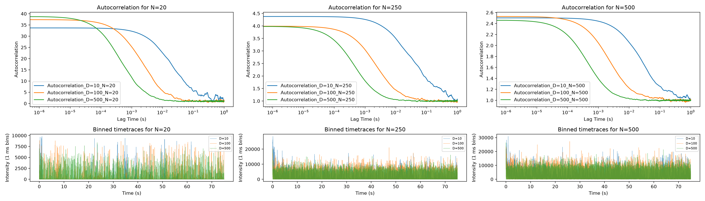
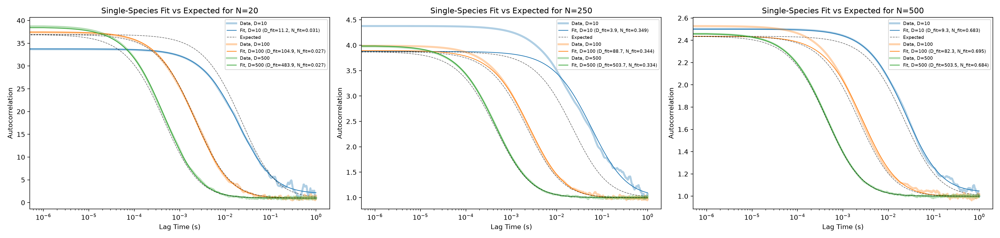

Diffusive Fluorescence Correlation Spectroscopy (FCS) Simulation

- Description:

This is a combined brownian motion and confocal fluorescence microscopy simulation. 3D diffusive Brownian motion is simulated for particles that interact with a defined confocal volume. The interaction between all particles and the confocal volume is then recoreded as a flurescence intensity time trace. We then validate this model based on the agreement between defined simulation parameters (particle concentration, particle diffusion constant, ect) and the Fluorescence Correlation Spectroscopic analyis of the fluorescence-intensity time trace generated by the simulation.

- Background:

The purpose of FCS is to extract information from a fluorescence intensity time trace by examining the timescales over which the fluorence intenisty becomes uncorrelated with itself. All we care about is over what interval we can expect a fluorescent signal to become uncorrelated with itself. 

- Model:
    - Diffusing Particle Model:
    
    A diffusing particle is represented by a set of cartesian coordiantes. We split the particles diffusion into 3 axis, x, y, and z; and let the particle walk randomly in each each axis independently by sampling from a normal distribution of mean 0 and std deviation equal to the sqrt(Mean Squared Displacement) given by a real diffusing particle of the same diffusion coefficient. The total MSD for a real particle is (6D(deltaT)), but component-wise is (2D(deltaT)) in x, y, and z axis. We can split these to make computation easier because of the orthogonality of cartesian coordinates. For a pure diffusion model, we assume that all motion is due to random walks, and none due to an initial velocity of the particle. 

    xt+1 = xt + 𝒩(0, √(2DΔt)) 
    yt+1 = yt + 𝒩(0, √(2DΔt)) 
    zt+1 = zt + 𝒩(0, √(2DΔt))

    Where 𝒩(μ, σ) is a random sample from the normal distribution with mean μ and standard deviation σ.

    - Confocal Volume Model and Interaction with Particle Fluorescence:

    In addition to a set of coordiantes, a particle is given a constant molecular brightness in units of photons emmited per second per unit laser power. The confocal volume is represented as a 3-Dimensional Gaussian centered at the origin of the simulated volume, at the center of which, the power is 1 arbitrary unit. 

    Each particle's brightness is dependent on the laser power it experiences based on its location. In order to model only diffusion of the system I assume that all photons emmited by the fluroescent particle are detected and neglect effects such as detection efficiency fluctuations due to rotations, photobleaching, fluorophore 'blinking' due to phosphorescence, anisotropy, ect. 

    These fluorescence intensities from all particles are combined into an overall photon detected intensity time trace as the final product of the simulation.

    - To model a system of n different species, we simply change the diffusion coeffiecent that scales the particles position, and its molecular brightness value.

    - If one wants to introduce noise to the model, it can be done easily by adding noise to the time trace before autocorrelation. 

- Model Validation:

The validity of this simulation can be deteremined by time-trace analysis on the intensity trace as would be done with data collected from a physical fluorescence microscope. 

Many physical parameters of the system can be recovered from the Fluorescence Correlation Spectroscopic Analysis of a time trace generated by fluorescence microscopy experiment. 

We can verify that the parameters determined by FCS analysis of the simulated time trace matches the experimental parameters that define the simulation.

Major parameters that can be determined through FCS analysis are: fluorophore concentration are fluorescent particle diffusion coefficient if the confocal volume paramters are known; or the confocal volume paramters (effective volume and beam aspect ratio) if the fluorescent particle diffusion coefficient is known (or alternatively a simulated dilution series is performed).

For this case, we choose to recover the concentration and diffusion coefficient parameters from FCS analysis of the intensity signal autocorrelation of the simulation. I show that, given that we simulate at a small enough \delta t for the given diffusion coefficient, and 
run the simulation long enough to measure a sufficient number of particles, the intensity autocorrelation very closely matches the model for our parameters.

Validation figures here: 

description: Intensity versus time "time trace" for simulated data paired with autocorrelations of the time trace at different experimental paramters for a single diffusing species. An experimental timestep is selected that is much smaller than the experimental timestep, if this is satisfied we have a continuious time approximation for the dynamics we seek to investigate. For all simulations, a total simulation time of 75 seconds was chosen; this total simulation time is not ideal in all cases for the parameters chosen, but does reflect trends expected and observed in real FCS data that undersamples the correlation function and provides some interesting insights into real FCS experiments. As far as ACF shapes, we see the trends we expect as well; as slower diffusing particles shift the ACF decay towards larger timescales, and increasing concentration decreases the amplitude of the ACF. 

Descriptions: results from fitting the autocorrealtion function generated by simulation to a single diffusing species FCS model. From these fit funcitons, we can can solve for our expected simulation parameters such as concentration and diffusion coefficient. How well the data fits the correlation function and resolves input parameters is an indication of correctness for our simulation.

Notes on results and fits:
 - each simulation ran for the same total duration; this means that more dilute and slower diffusing species were measured much less often than faster and more concentrated samples. less overal measurements of a species for a sample means a larger expected deviation from the expected autocorrelation function for the experimental paramters. This explains the trends in how well we can both recover experimental paramters and how well the model fits our actual ACF in these experiments. 

- Table of fits: 
Description: each simulation ran for the same total duration; this means that more dilute and slower diffusing species were measured much less often than faster and more concentrated samples. less overal measurements of a species for a sample means a larger expected deviation from the expected autocorrelation function for the experimental paramters. This explains the trends in how well we can both recover experimental paramters and how well the model fits our actual ACF in these experiments.

<!-- fit-table:start -->
| Particles in box | D true (µm²/s) | D fit (µm²/s) | D error (%) | ⟨N⟩ in volume, expected | ⟨N⟩ in volume, fit |
|---:|---:|---:|---:|---:|---:|
| 20 | 10 | 11.21 | +12.1 | 0.0278 | 0.0315 |
| 20 | 100 | 104.94 | +4.9 | 0.0278 | 0.0274 |
| 20 | 500 | 483.88 | -3.2 | 0.0278 | 0.0267 |
| 250 | 10 | 3.89 | -61.1 | 0.3480 | 0.3493 |
| 250 | 100 | 88.68 | -11.3 | 0.3480 | 0.3441 |
| 250 | 500 | 503.68 | +0.7 | 0.3480 | 0.3342 |
| 500 | 10 | 9.26 | -7.4 | 0.6960 | 0.6826 |
| 500 | 100 | 82.32 | -17.7 | 0.6960 | 0.6953 |
| 500 | 500 | 503.47 | +0.7 | 0.6960 | 0.6843 |
<!-- fit-table:end -->

- Investigation of Multispecies Systems:

- Multiprocessing Optimizations:

- Cuda Optimizations:

